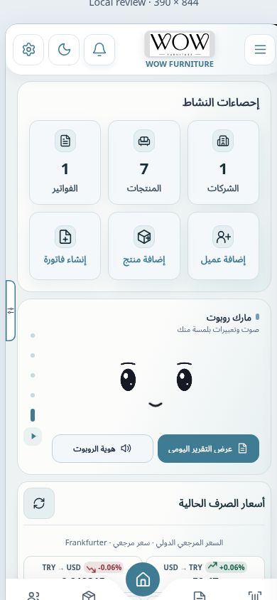

# Release 198 — Unified WOW FURNITURE workspaces

## Purpose

Unify the application around its existing WOW FURNITURE identity, repair the
showroom selection/preview stalls and bottom clipping, and make the developer
profile work without scrolling. Replace the unused global voice button with an
empty notifications destination that can be populated later.

## Changes

- Shared fixed/sticky header styling, consistent controls and safe-area spacing
  across the home page, internal pages and dialogs. On short phone viewports,
  page actions can scroll while the title, back, menu and notification controls
  remain available.
- Consolidated the duplicated bottom space reservations. The last content card
  remains above the bottom navigation without the former oversized blank gap.
- Preserved horizontal gestures for product queues and tab strips, and the
  existing single scroll owner inside dialogs.
- Added a shared notifications bell and an empty page in all five application
  languages. Back/Forward history and focus restoration are supported. There
  are no fabricated notifications or notification permission prompts.
- Removed the global voice control and its selection observers. Existing Mark
  report/identity playback remains a separate feature.
- Reworked the developer profile into five logical sections with measured
  pagination, persistent navigation and a static Mark robot badge. Long sections
  split into additional pages according to the available height. The original
  close behavior, text and portrait are retained.
- Replaced the retired default brand with WOW FURNITURE in the application,
  installation metadata and developer profile. Old default identities migrate
  on read, including their old uploaded artwork; unrelated customized identities
  and business data remain intact. Retired logo assets are removed.
- Added a faithful SVG trace of the existing WOW/FURNITURE lockup, preserving
  the original proportions, spaced subtitle and horizontal rules. A 1692 × 660
  PNG is rendered from that vector, replacing the 423 × 165 source for the app
  identity. This is a reconstructed vector asset, not a claim to an original
  brand-master file. Regenerated installation/favicon assets and enlarged logo
  placements in the header, drawer, About and identity/developer sections.
- Indexed showroom product lookup and normalized search. Selection queues render
  25 cards at a time, with every selection still reachable and printable.
  Unchanged previews are reused, stale asynchronous work is cancelled, and batch
  preparation yields periodically instead of monopolizing the main thread.
- Corrected a preview preparation race so a batch failure cannot leave a stale
  product paper presented as the current preview.
- Updated the offline cache and resource versions together for release 198.

## Verification

- `node --test tests/*.test.cjs tests/*.test.mjs`: **764 passed, 0 failed**.
- `npm test`: **6 passed, 0 failed**, including inline-script syntax and all five
  locale consistency checks.
- Syntax checks passed for the changed JavaScript modules and service worker;
  the CRLF-aware Git whitespace check passed.
- Browser checks covered phone, tablet and desktop viewport sizes, Arabic RTL,
  long Russian translations, light/dark themes, native dialog scrolling and
  translated header controls. The 16 top-level pages inspected at a 320 px
  viewport had no outer horizontal overflow, one visible notifications bell
  and no old global voice button.
- Developer profile: all ten Arabic and thirteen Russian pages at 320 × 360
  fit without scroll overflow. Checks also passed at 390 × 844 and 1280 × 900.
- The real top-level browser history sequence products → notifications → Back
  → Forward returned to the expected page in both directions.
- An 80-product selection kept the full count while rendering a bounded queue;
  searching did not discard the selection. An intentionally oversized card
  showed its localized validation error and disabled printing.
- At the end of the small clients page, the final card remained 32.5 px above
  the bottom navigation after the duplicate bottom padding was removed.
- The physical card/print geometry CSS is byte-for-byte unchanged from release
  197. One landscape A4 sheet per selected product still contains two identical
  upright 100 × 150 mm faces, a 200 × 150 mm joined piece, an outer cut boundary
  and a center fold. Print language remains independent of application language.

These are automated and browser viewport checks, not tests on physical iPhone,
Android hardware or a physical printer. The screenshot below uses local sample
data and shows the enlarged logo, shared header, bell and existing Mark card.

## Design references

- [Apple Human Interface Guidelines — Toolbars](https://developer.apple.com/design/human-interface-guidelines/toolbars)
- [Apple Human Interface Guidelines — Layout](https://developer.apple.com/design/human-interface-guidelines/layout)
- [Android — App bars](https://developer.android.com/develop/ui/compose/components/app-bars)
- [GitHub Primer — Dialog](https://primer.style/product/components/dialog/)

References informed the shared hierarchy, reachable controls and dialog focus
behavior; the implementation keeps the application's existing visual identity.
